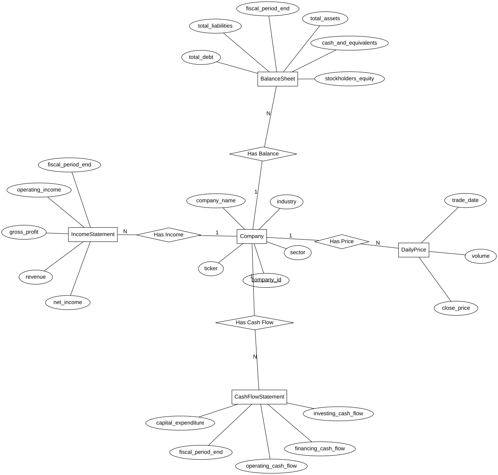

# CSC370 — TSX Financial Database Project

This project aims to build a relational database for financial information about major companies listed on the Toronto Stock Exchange (TSX).

## 1.1 — Initial Project Direction

**Goal:** Develop a database for organizing and analyzing company financial information.

- Discussed the project scope and possible database applications.
- Decided to focus on approximately 60 major TSX-listed companies.
- Identified company information, stock prices, and financial statements as potential data sources.
- Prioritized basic financial analysis, including financial stability, profitability, and growth.
- Decided to focus on data collection and database structure before considering additional analytical features.

**AI Usage:** ChatGPT was used to discuss project ideas, evaluate the feasibility of collecting financial data, and explore possible database structures. The project direction was determined through discussions between the student and AI.

## 1.2 — Initial Data Collection Test

**Goal:** Verify that financial data can be collected successfully and identify which information is available for database design.

- Developed a Python script using `yfinance` to retrieve data from Yahoo Finance.
- Tested data collection using 10 TSX-listed companies.
- Collected company information, daily stock prices, and annual financial statement data.
- Organized the results into CSV files.
- Examined missing financial information to understand data availability and limitations.

**Results:**
- `companies.csv`: 10 records
- `daily_prices.csv`: 230 records
- `annual_financials.csv`: 47 records
- `data_issues.csv`: 49 missing-data records

**AI Usage:** ChatGPT generated the Python data collection script, suggested the CSV structure, and helped interpret the results. The student configured the development environment, executed the script, inspected the collected data, and reviewed the missing-data issues.

**Status:** Initial data collection test completed. The database schema and ERD have not yet been finalized.

### 1.2.1 — Data Management Decisions

**Purpose:** Establish the initial database direction based on the successful data collection test.

#### Data Source and Stock Prices
- Yahoo Finance will be used as the primary financial data source through the Python `yfinance` library.
- The data collection script is located at `scripts/fetch_tsx.py`.
- Although Yahoo Finance provides frequently updated stock prices, this project will focus on **daily closing prices** to examine historical stock trends rather than track real-time market movements.
- The target historical stock price period is **5 years**.
- The initial test confirmed that financial data can be retrieved and organized. The collection process will be expanded after the database structure is established.

#### Initial Database Structure
The database will initially contain three entities:

1. **Company** — Stores company names, Yahoo Finance tickers, and basic company information.
2. **DailyPrice** — Stores historical daily stock prices and trading volumes.
3. **AnnualFinancial** — Stores annual financial information for evaluating company performance and financial stability.

The project will initially target approximately 60 TSX-listed companies.

Companies will be organized alphabetically by their Yahoo Finance ticker symbols. Each company will have an internal `company_id`, while the ticker will serve as a unique stock identifier. Assigned company IDs will remain unchanged when additional companies are added.

#### Future Considerations
- Financial ratios such as P/E, P/B, and ROE may be calculated from stored financial data or compared with values provided by Yahoo Finance.
- Additional analytical features and automated data updates may be considered later.
- Detailed attributes, relationships, and constraints will be finalized during ERD and relational schema design.

#### AI Usage
ChatGPT was used to discuss data management options, compare real-time and daily stock price collection, and propose the initial three-entity structure. The student selected the daily closing price approach, five-year historical period, and initial database direction. The final ERD and SQL schema have not yet been implemented.
### 1.3 — Initial Conceptual ERD

Created an initial conceptual ERD for the TSX Financial Database.

**Design Decisions:**
- Defined five entities: `Company`, `DailyPrice`, `IncomeStatement`, `BalanceSheet`, and `CashFlowStatement`.
- Established one-to-many relationships between `Company` and each of the other four entities.
- Chose `company_id` as the primary identifier for companies, with an initial target of 60 major TSX stocks and the possibility of expanding to more companies later.
- Focused on daily closing prices and annual financial statements.

**AI Usage:**
- Used ChatGPT to discuss entity selection, attributes, identifiers, and relationships.
- Used ChatGPT to generate the initial Graphviz DOT code based on the design decisions.
- Reviewed the generated ERD visually before committing it.

**ERD:**

The ERD is an initial design and may be refined during relational schema development.git

### 1.4 — Relational Schema and SQL Implementation

Implemented the initial relational schema for the TSX Financial Database in MySQL.

**Design Decisions:**
- Used `company_id` as the primary key for `Company`.
- Used composite primary keys (`company_id`, `trade_date`) for `DailyPrice` and (`company_id`, `fiscal_period_end`) for the three financial statement tables.
- Defined foreign keys linking all four dependent tables to `Company`.
- Reviewed functional dependencies and BCNF. Based on the current assumptions, the five tables satisfy BCNF without further decomposition.
- Allowed `NULL` for unavailable financial values and added a non-negative price constraint.

**Implementation:**
- Created the five tables using `sql/schema.sql`.
- Executed the SQL DDL in MySQL.
- Verified the composite primary key, foreign key, and `CHECK` constraint on `DailyPrice`.

**AI Usage:**
- Used ChatGPT to explain primary keys, foreign keys, functional dependencies, and BCNF.
- Used ChatGPT to draft the SQL DDL based on the selected database design.
- Reviewed the schema and verified its implementation in MySQL.

## 2.0 — Sprint 1: Relational Design & Implementation

Sprint 1 focuses on validating the relational design of the TSX Financial Database and implementing it in MySQL.

The initial five-table design is reviewed using functional dependencies (FDs), candidate keys, BCNF, and 4NF.

## 2.1 — Relational Design Validation

The normalization analysis identified the functional dependency `industry → sector` in the original Company relation. Since `industry` is not a superkey, this violates BCNF.

To resolve this, the Industry relation was separated from Company, increasing the design from five to six tables.

The revised design:

- Satisfies BCNF under the identified functional dependencies.
- Supports lossless join and dependency preservation.
- Requires no further 4NF decomposition under the current business rules.

Each company stores one representative industry, consistent with the data provided by Yahoo Finance. The design supports both sector-level and industry-level company comparisons.

Detailed analysis: [Normalization and Relational Design Validation](docs/normalization.md).

## 2.2 — MySQL Schema Implementation

Implemented and verified the revised six-table MySQL schema based on the BCNF decomposition from Section 2.1.

**Implementation:**
- Added the `Industry` table with `industry` as its primary key and `sector` as an attribute.
- Removed `sector` from `Company` and established a foreign key from `Company.industry` to `Industry.industry`.
- Preserved the existing `DailyPrice`, `IncomeStatement`, `BalanceSheet`, and `CashFlowStatement` table definitions.
- Maintained the data types and primary key, foreign key, unique, and CHECK constraints.

**Validation:**
- Confirmed that all six tables exist in MySQL.
- Verified the `Company` and `Industry` table definitions.
- Verified the composite primary key, foreign key, and non-negative price CHECK constraint in `DailyPrice`.
- Confirmed that all three financial statement tables have primary key and foreign key constraints.

**AI Usage:**
ChatGPT assisted with revising the SQL DDL, explaining schema recreation and migration, and preparing SQL queries to verify the resulting database structure. The student executed the SQL and reviewed the validation results.